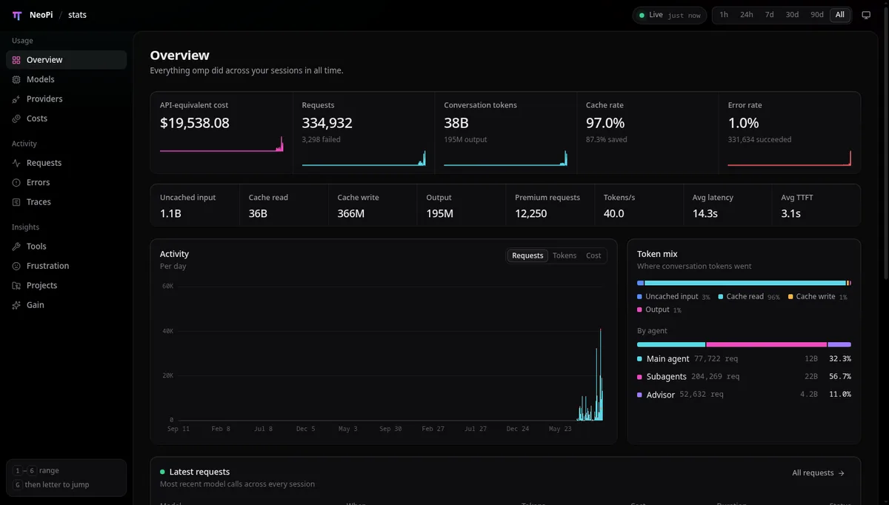
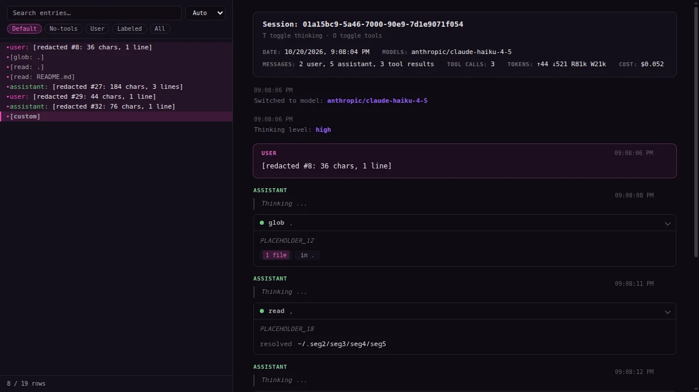
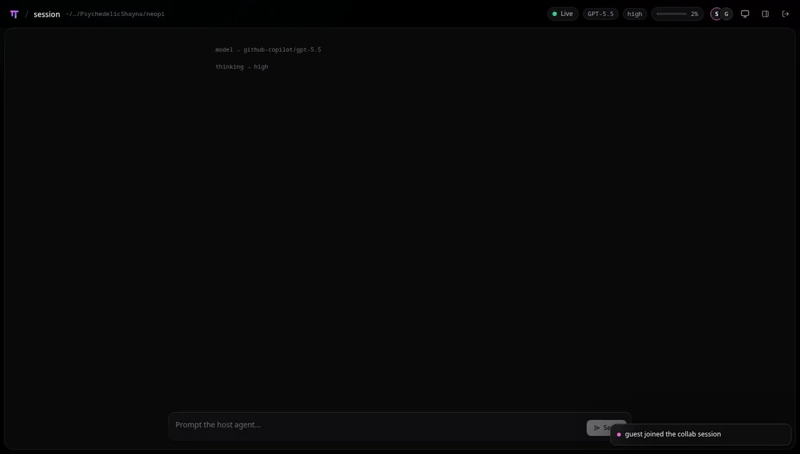
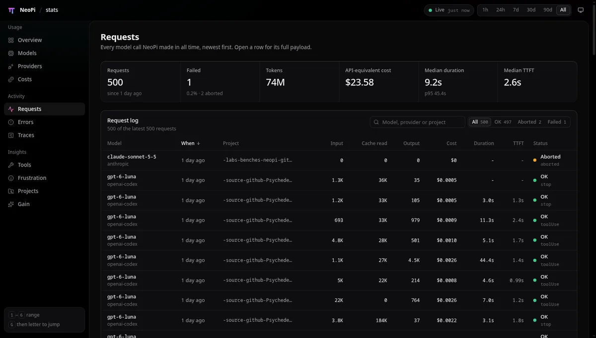
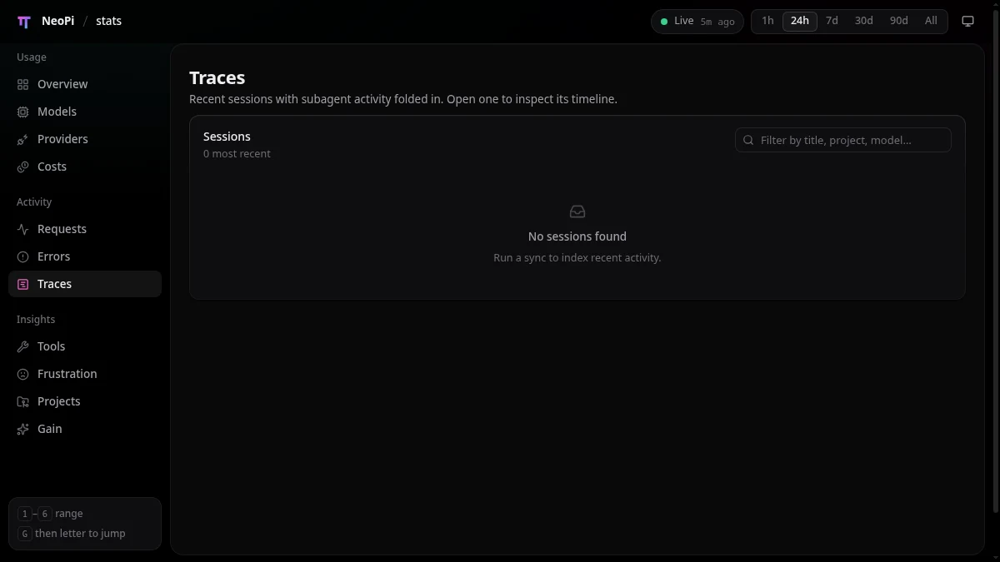
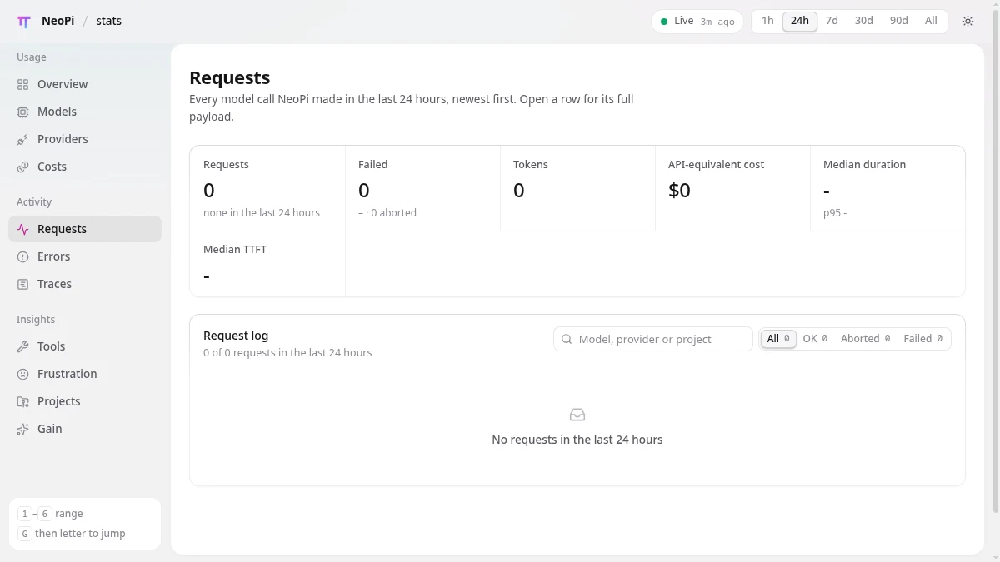

# Neo design language

What NeoPi's web surfaces (`/stats`, `/collab`, `/share`) already do, written down so
NeoProxy's dashboard and every later Neo surface read as one system. Extracted
2026-10-20 from NeoPi nightly 18.10.3 by driving each page in a real Chromium
window on an Xvfb display and reading its DOM and computed styles. Reference
screenshots are in [`screenshots/reference/`](screenshots/reference/).

## The three sources

| Surface | What it is | Chassis | Role in this document |
|---|---|---|---|
| `/stats` | Preact dashboard: sidebar, topbar, KPI strips, tables, charts, trace timeline | pure black `#000`, inset panel `#09090a` | layout system, components, typography |
| `/collab` (my.omp.sh) | live session viewer: topbar with breadcrumb, status chips, composer, toasts | same tokens as `/stats` | chips, toasts, composer, live indicator |
| `/share` | exported transcript HTML: resizable tree sidebar, message cards, tool blocks | purple-black `#0f0b14`, raised `#16111c` | the purple tint, message/tool card patterns, mono density |

`/stats` and `/collab` share one token file (`--bg`, `--panel`, `--card`,
`--ink-*`, `--accent-a/b`). `/share` uses the TUI palette, which is the purple
one. Both read as the same brand because the accent, hairline logic, radii and
typography are identical; only the chassis hue differs. NeoProxy uses the
`/stats` structure on the `/share` chassis so it is unmistakably the purple
family and still lays out like the dashboard.





## Tokens

Measured values, dark theme. Light theme exists on `/stats` and `/share` and
flips the same names; see "Light".

### Surface ramp

Each step rises one notch off the page. Never more than four steps on screen.

| Token | `/stats` | `/share` | NeoProxy |
|---|---|---|---|
| `--bg` (page) | `#000` | `#0f0b14` | `#0b0810` |
| `--panel` (the one big inset panel) | `#09090a` | `#09060c` inset | `#100c16` |
| `--card` | `#0e0e10` | `#16111c` raised | `#16111d` |
| `--raised` (popovers, hover rows) | `#17171a` | `#211b28` overlay | `#1e1826` |
| `--hover` | `rgba(255,255,255,.035)` | 5% text wash | same |
| `--selected` | `rgba(255,255,255,.075)` | accent-muted 18% | same as stats |

### Hairlines

Alpha, so one value works on every step: `--line-1: rgba(255,255,255,.06)`,
`--line-2: .09`, `--line-3: .14`, `--line-4: .22`. Cards are separated by
hairlines and a 1px inset highlight, not by shadows. Shadows exist only for
floating things (`--shadow-2` popovers, `--shadow-3` dialogs).

### Ink

`--ink-1: #ededef` (primary), `--ink-2: #a0a0a8` (secondary, descriptions,
nav), `--ink-3: #6c6c74` (table headers, axis labels), `--ink-4: #46464c`
(keyboard hints). `/share` uses `#e6e3ea / #a49faa / #6e6974`, the same ramp
with a warmer tint.

### Accent

One gradient, cyan to pink: `--accent-a: #5ad8e6` → `--accent-b: #ed4abf`,
`--accent-gradient: linear-gradient(100deg, a, b)`. Solid `--accent: #f068c8`
for text and strokes, `--accent-soft: rgba(237,74,191,.14)` for fills,
`--accent-line: .35` for borders. `/share` adds a violet `#945ff9` for
system/custom labels; the brand mark gradient runs pink → violet → cyan
(`oklch(0.7 0.24 340)`, `oklch(0.62 0.21 295)`, `oklch(0.81 0.14 200)`). The
gradient is for hero marks and the KPI underline; it is not a button fill.

### Status

`--ok: #3ecf8e`, `--warn: #f5a524`, `--bad: #ff6166`, each with a 13% `-soft`
fill. `--live: #3ecf8e` is reserved for the real-time presence dot. Every
status reads as a colored dot + word, never color alone.

Action feedback describes the completed operation, not merely its HTTP status.
Credential batch refreshes report the refreshed and failed counts because the
engine returns HTTP 200 even when every token fails. Clipboard actions show
"Copied" only after the browser accepts the write; denied writes show
"Clipboard unavailable".

The regression test for the previous dashboard's batch-result rendering was
removed with that dashboard; the new one verifies its pages by driving them in
Chromium (see `docs/design/backend-contracts.md` for the fixture it runs on).

### Type

- Sans: `"Inter var", Inter, ui-sans-serif, system-ui`. Mono: `ui-monospace,
  "SF Mono", "JetBrains Mono", Menlo, Consolas`.
- Body 13.5px / 1.5. Table cells 13px, headers 12px weight 500 in `--ink-3`.
- Page title 22px weight 600, letter-spacing −0.02em; description 13.5px
  `--ink-2` directly under it.
- KPI value 24px weight 550, −0.025em; KPI label 12.5px weight 500 `--ink-2`;
  KPI sub-line 12px `--ink-3`.
- Identifiers (model ids, provider ids, keys, paths, counts in badges) are
  always mono. Prose is sans. `/share` is all-mono at 12px because it is a
  transcript; dashboards are not.
- Keyboard hints: 10.5px mono in `--ink-4` inside a hairline `kbd`.

### Radii and spacing

`--r-chip: 6px`, `--r-control: 8px`, `--r-card: 12px`, `--r-panel: 16px`,
`--r-pill: 999px`. Topbar 52px, sidebar 224px, page gutter 28px. Card padding
14–16px; KPI cell `14px 16px 12px`; table cell `9px 12px 9px 16px`; nav row
32px tall, 8px radius, `0 10px` padding.

### Motion

`--ease: cubic-bezier(.2,0,0,1)`, 120 / 200 / 360ms, 40ms stagger. Cards get a
`.rise` entrance (opacity + 4px translate). Nothing bounces.

## Layout

```
┌ topbar (52px, translucent black, hairline bottom) ──────────────────────┐
│ mark · Brand / page · · · · · · · · · · · · live-chip · segmented · icon │
├ sidebar 224px ─┬ main: one inset panel (--panel, r-panel 16px, hairline)─┤
│ group label    │ h1 + description                                       │
│ nav rows       │ KPI strip (cells divided by hairlines, no gaps)         │
│ …              │ secondary KPI strip (smaller)                           │
│                │ cards in a 2-column grid (chart | breakdown)            │
│ kbd hints      │ full-width table card                                   │
└────────────────┴─────────────────────────────────────────────────────────┘
```

- The sidebar sits on the page background; the content is one raised panel.
  Cards sit inside the panel one notch up. This "page → panel → card" nesting
  is the single strongest visual signature; reproduce it exactly.
- Nav is grouped (`Usage`, `Activity`, `Insights`) with 11px uppercase-ish
  group labels in `--ink-3`, 32px rows, icon 16px + label, active row
  `--selected` with `--ink-1` text, every row carrying a two-key chord
  (`G O`) shown on hover and in the sidebar footer hint box.
- Topbar: brand mark (22px) + `Brand` + `/` + page name in `--ink-2`; right
  side holds the live chip, a segmented range control, and icon buttons.
- Breadcrumb inside a page: `← Sessions` link in `--ink-2` above the h1
  (trace detail).
- Mobile (< 900px): sidebar becomes an overlay opened from a hamburger; the
  panel loses its radius and gutter.

## Components

- **KPI strip**: a card whose children are cells divided by `--line-1`
  hairlines; label, value, sub-line, optional sparkline or a 2px accent
  underline. Primary strip has 5–6 cells, the secondary 8 small ones.
- **Card**: `--card` background, 12px radius, hairline border, header
  (title 14px weight 600 + 12.5px description, actions on the right), body.
- **Table**: header row on `--card` with `--ink-3` 12px labels, sortable
  column shows an arrow, right-aligned numerics in mono, hairline row
  separators, hover wash, selectable rows (`aria-selected` → `--selected`).
  Inline bars (`share`, `tokens`) are 60px hairline tracks with an accent fill.
- **Badge / pill**: 20px tall, 999px radius, 11px mono, soft status fill with
  status text color (`0.4%` in ok-soft/ok).
- **Chip**: live chip is a 30px pill with a pulsing dot and a `just now`
  mono suffix; model/effort chips in `/collab` are the same shape in mono.
- **Segmented control**: pills inside a hairline track, pressed segment on
  `--raised` with `--ink-1`.
- **Buttons**: ghost by default (`--ink-2`, hairline on hover), primary is a
  solid `--ink-1` on `--ink-inverse` (not the gradient), danger uses `--bad`.
  Icon-only buttons are 30px squares with 8px radius.
- **Inputs**: 32px, `--card` background, `--line-2` border, focus ring
  `--focus` (cyan). Search inputs carry a leading icon.
- **Empty state**: centered icon in `--ink-3`, 14px title, 12.5px hint
  (`No sessions found · Run a sync to index recent activity`).
- **Toast**: bottom-right, `--raised`, hairline, colored dot + text.
- **Composer** (`/collab`): full-width pill-ish input docked at the bottom
  with a primary `Send` button inside it.
- **Transcript / tool block** (`/share`): role label in 10.5px uppercase
  mono, timestamp right-aligned in `--ink-3`, tool call as a collapsible row
  with a status dot, tool name, argument, chevron; code in `--panel` with a
  line gutter.
- **Timeline** (`/stats` trace): lanes labelled on the left in `--ink-2`, span
  colors by kind (input grey, model cyan, tool amber, agent pink, background
  grey), a minimap above, legend on the right, keyboard help line in `--ink-3`.




## Light

`[data-theme="light"]`: `--bg: #f2f2f3`, panel/card white, raised `#f6f6f7`,
hairlines become black alphas at the same strengths, ink `#151518 / #5a5a63 /
#8b8b94`, accent `#c42596` with cyan `#1fa9bb`. Theme is chosen by a
three-state control (auto / light / dark) and remembered in `localStorage`.
NeoProxy ships the same control.



## Do

- Nest page → panel → card; separate with hairlines, not shadows or gaps.
- One accent. Status colors only for status. Gradient only for the mark and
  hero underlines.
- Mono for identifiers and numbers, sans for prose; right-align numbers.
- Give every page a title and a one-line description that says what the
  numbers mean ("Cost is an API-equivalent estimate").
- Make everything keyboard reachable: `G` chords for navigation, digit keys
  for ranges, `Esc` to deselect, `/` to search.
- Show an honest empty state with the action that fills it.
- Animate entrance only; keep it under 400ms.

## Don't

- No colored card backgrounds, no gradients as fills, no drop shadows on
  resting cards.
- No all-caps headings; group labels are the only small-caps-ish text.
- No icon-only actions without a tooltip and an `aria-label`.
- No tables without hairline rows; no numbers in sans.
- No modal for something that fits in a card.
- No second accent hue (the violet is reserved for system/custom labels).

## Components NeoProxy adds (shared by name with NeoDeck)

- **Usage ring** (`.neo-ring`): a 3px track with a cyan fill for the used
  fraction and an optional dashed outer marker for the budget. Turns `--warn`
  at 80% of the budget and `--bad` at or over it. Sizes 22–40px; the label
  inside is 11px mono. Used for account windows, stage pools, and allotments.
- **Chain rail** (`.neo-chain`): a horizontal list of fixed-width nodes
  (request → stage… → terminal) joined by hairline links with an arrow and a
  10px mono caption (`demote`, `then`). Nodes are `--card` on `--panel`,
  12px radius; the selected node gets an accent outline, the node a simulated
  request lands on gets a cyan outline and a `lands here` caption. `.compact`
  drops the request node, the served-name line and captions for list use;
  `.editor` narrows the nodes and puts a round `+` on the last link.
- **Preview chip** (`.neo-preview`): 20px hairline chip, 11px mono, `--ink-3`,
  text `preview data`, placed after the page title. It means the page is served
  by the fixture adapter, not that the page is unfinished. Never a banner.
- **Flow board** (`.flow`): three fixed columns of 44px rows with an SVG
  overlay of cubic ribbons between them; ribbon width is usage share, pink for
  vault → virtual model, cyan for virtual model → user. Selecting a row traces
  away from it (downstream from a provider, upstream from a user, one hop from
  a virtual model); everything else dims to 35%.
- **Docked inspector** (`.inspector`): a 360px right column inside the panel,
  hairline on the left, with a head, a scrolling body of `.section`s and a
  foot for actions. It replaces modals for anything that is a detail of a
  selected row. `Esc` closes it. Below 900px it stacks under the page.
- **Trail** (`.trail`): the routing explanation for one request: numbered
  steps, the serving step outlined in cyan, skipped steps at 70%, the end step
  on `--panel`.

## How NeoProxy applies it

- Chassis from `/share` (purple-black), structure and components from
  `/stats`, chips/toasts from `/collab`. NeoDeck sits on `/stats`' pure black;
  the two read as one family because every other token is identical.
- NeoPi is the centre: the first nav group (`NeoPi`: Overview, Core link), the
  topbar's first chip, and the left column of the Overview flow board. The
  engine's own surfaces are the last group (`Engine`), reachable, never
  highlighted.
- Virtual models are the product. They are the middle column of the flow
  board, the first card on Models, and the only pages with a bespoke editor.
  Everything else is a list, a table, or a docked inspector.
- Members and admins share one app. A member's sidebar is `Activity`, `My
  models`, `About`; a member never sees account labels, vault internals, or
  another user's data.
- Fixture-backed pages carry the preview chip; engine-backed pages do not.
  The upstream control panel stays at `/management.html` as the escape hatch
  and is linked from About.

### Office-walk refinements (2026-10-30)

The GPT-6.1 Terra office walk and Opus 5.5 design critique exposed layout and
interaction defects, not a need for a different visual language. Keep the tokens
above unchanged.

- At narrow widths the topbar must not establish a min-content floor for the
  shell. CSS owns menu visibility, including after resize. On phones the mark
  carries the brand, endpoint details stay in chip titles, and the user chip
  truncates without pushing out sign-out.
- The Models toolbar wraps; provider metadata moves below its name and switch.
  Model identifiers wrap rather than losing their meaningful tail. Compact
  virtual-model teasers clip with an edge fade, not a nested scroll surface
  inside their button. Full chains remain horizontally scrollable.
  Dense tables keep their column/sort structure in a keyboard-focusable local
  scroll region; toolbars and card actions wrap rather than widening the page.
- The served-model summary derives from the same effective provider/model
  exposure state as the rows after each completed change. Empty inventory asks
  for a credential; genuine filter misses retain their search guidance.
- Focus a stage and press **Alt+Left** or **Alt+Right** to reorder it. Selection
  is not required. Focus follows the same stage through rail replacement and
  simulation updates; a quiet live region announces moves and boundaries.
  **Enter** and **Space** open stage and terminal inspectors. **Escape** closes
  the inspector. Reordering changes the draft: save before simulating it.
- Script save errors persist beside Lua source, with the server's original
  diagnostic, until edited. Rejected script results are named as such and offer
  **Edit script**, rather than pretending the model failed to load.
- Configured token windows show measured tokens against capacity and a
  **local meter** tag. They are local routing budgets; provider quota remains
  unknown. Unknown plan or provider quota must not become inferred values.

Check these behaviours in the compiled dashboard with real persisted account
and model data, not a substitute fixture. The focused resolver oracle remains
useful for routing arithmetic, but does not prove browser interaction, upstream
inference, provider quota, OAuth, or released-client acceptance.
